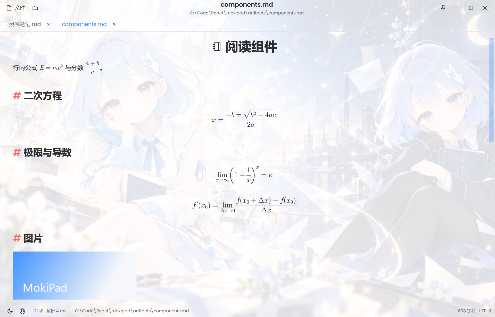

# MokiPad

MokiDown 的原生 Windows Markdown 阅读器。沿用 MokiDown 的蓝色、明暗配色、圆角与星光书页背景，交互保持轻量：文件下拉、标签页、居中的文件名与路径、单行状态栏。

独立项目目录：`C:\Code\React\mokipad`。不依赖 MokiDown 的运行环境，也不在 MokiDown 目录内发布。




解决方案结构、项目依赖、构建方式与 InspectCode 检查摘要见 [docs/solution.html](docs/solution.html)；逐条规则的处理说明、原因与完整 diff 见 [docs/code-quality-report.html](docs/code-quality-report.html)；按修改类型整理的 Markdown（含改前/改后代码）见 [docs/code-cleanup-changes.md](docs/code-cleanup-changes.md)。

第一次接触 WPF 或 C# 的读者，从 [docs/beginner-guide.md](docs/beginner-guide.md) 开始；配套知识树是 [docs/beginner-guide.mgtree](docs/beginner-guide.mgtree)，用 MokiDown 打开可按键浏览章节和代码示例。

## 运行

需要 Windows 10/11 与 .NET 10 SDK。可用 Visual Studio 或 Rider 打开 `MokiPad.sln`（新版 IDE 也支持 `MokiPad.slnx`），或在项目目录执行：

```powershell
.\scripts\dev.ps1
.\scripts\dev.ps1 "C:\Notes\长文.md"
```

生成发布目录（需要 .NET 10 Desktop Runtime）：

```powershell
.\scripts\publish.ps1
.\artifacts\app\MokiPad.exe
```

携带 .NET 运行时的独立版本：

```powershell
.\scripts\publish.ps1 -SelfContained
```

按文件夹发布，避免单文件启动时的释放步骤。窗口先显示阅读界面，文件在后台读取、解析，长文不会阻塞首帧；启动时不恢复历史文档或加载工作区。

## 当前功能

- 多标签打开、切换与关闭；命令行参数和拖放打开文件；文件按只读快照载入，不修改原文件。
- 居中显示文件名与路径；标签中键关闭，右键关闭其他/全部；加号跟随标签并在悬停时显示。
- Markdown 原生预览：标题、强调、行内代码、引用、任务列表、代码围栏、链接、表格；长行内代码自动换行，不会撑破阅读栏。
- 数学公式：`$...$` 行内与 `$$...$$` 块级，交给 WpfMath 排版，支持分式、根式、上下标、极限、积分、矩阵、希腊字母等常用 TeX；公式跟随主题前景色。
- 图片：相对/绝对/`file://` 本地路径，`http(s)` 与 `data:` 远程图片；支持 PNG/JPEG、SVG 矢量图（含 shields 徽章及其内嵌 logo）与 GIF 原始分辨率内联逐帧播放（后台解码、固定像素缓冲，离开视口暂停）；尊重 `width`/`height` 属性，等比缩放到阅读栏宽度，失败时保留替代文字。
- 原始 HTML 的安全子集：`p`/`div`/`h1`–`h6` 按块级排版，`align="center"` 居中；`kbd`、`mark`、`sub`、`sup`、`br`、`a`、`img`、`details` 等按阅读样式呈现，脚本与样式内容会被丢弃。
- 表格单元格渲染完整内联内容（图片、行内代码、链接、公式），列对齐取自 Markdown 表格的 `:` 标记；截图类表格中的图片会缩放到列宽。
- 链接：外链用系统浏览器打开，本地文件在应用内新标签打开，`#锚点` 在文内滚动并短暂高亮；脚注引用可跳到定义，定义处的 ↩ 可回到引用。
- 脚注：`[^id]` 引用与定义会被收拢成文末脚注列表。
- 代码围栏使用轻量词法着色（One Light / One Dark），覆盖 PowerShell/Shell 命令、参数、变量及常见语言关键字、字符串、数字和函数调用；代码块可一键复制。
- 任务列表只展示勾选状态，不写回源码；阅读界面没有编辑入口，双击正文不切换模式。
- 源码选择复制：拖选、Shift 扩选、Ctrl+A/C；普通文字支持局部选择，图片/公式/表格/HTML/代码块保留完整 Markdown 语法，引用式图片与脚注附带所需定义。长文选区独立于容器回收，详见 [选择复制说明](docs/markdown-copy.md)。
- 阅读字号可调（10–28），Ctrl+滚轮或 Ctrl+= / Ctrl+- 缩放，Ctrl+0 恢复默认；F5 重新加载当前文件。
- 明暗主题、中英文界面、自定义背景、背景开关、窗口置顶。
- 保留 UTF-8 / BOM、UTF-16、GB18030 编码识别；只读打开，不提供保存。

## 快捷键

| 操作 | 快捷键 |
| --- | --- |
| 打开 | Ctrl+O |
| 关闭标签 | Ctrl+W |
| 切换标签 | Ctrl+Tab |
| 复制所选 Markdown / 全选 | Ctrl+C / Ctrl+A |
| 清除选区 | Escape |
| 重新加载 | F5 |
| 放大 / 缩小 | Ctrl+滚轮 或 Ctrl+= / Ctrl+- |
| 默认字号 | Ctrl+0 |
| 最大化 / 还原 | F11 |

## 与 MokiDown 互补

MokiDown 继续承担所见即所得、知识树、代码运行、插件与完整知识工作台。MokiPad 只做一件事：直接打开本地 Markdown，专注、安静地读长文。

当前版本是可运行的原生阅读器基础版：没有移植 Milkdown 所见即所得、mgtree 可视编辑、代码执行、Mermaid 图表和插件系统。数学公式、图片、脚注与常用 HTML 已按 MokiDown 阅读界面的方式补齐。

## 性能设计与验证

阅读字体打包 MokiDown 同款 Poppins 与 JetBrains Mono，中文沿用系统回退；一级标题使用相同的笔记本图标路径，二级标题使用红色井号。引用块保留原 Markdown 的换行，明暗蓝色底色与 MokiDown 对齐。滚轮在代码块、引用块和表格上继续滚动正文，使用短时平滑过渡；Shift+滚轮可横向滚动代码。

图片读取与解码合并并发请求，原始数据和已解码图片分别使用有界缓存（96 MiB / 128 MiB）。静态图片按显示宽度与 DPI 解码，放大窗口后补充更高分辨率，不再固定限制到 1600 像素；SVG 在独立 STA 线程中矢量渲染。

文件在后台读取并解析成不可变快照，使用版本号和取消令牌丢弃旧结果；窗口先显示可读界面，长文不会阻塞首帧。预览使用支持回收的 `VirtualizingStackPanel`，外层不再嵌套 `ScrollViewer`。单个超长代码块/段落分成最多 4096 字符的内容块，表格每组最多 32 行数据，完整内容保留。超过约 2M 字符的文档在切换标签后释放解析缓存。数学公式、图片与脚注只在对应块进入视口时创建：WpfMath 负责 TeX 排版，图片解码结果在内存中复用，远程图片按需下载并缓存到本地；GIF 用 SkiaSharp 在后台按原始分辨率解码，复用同一个 WPF 位图更新像素，不再逐帧触发布局、周期性重建解码器或强制 GC；离开视口暂停，控件回收后释放。

Markdig 仍然解析整份快照，因此解析时间和文档内存随文本量增长；UI 虚拟化不代表文档数据完全按需读取。对超大单行、超宽表格和百万级标题还需要进一步专门优化。这里没有宣称已胜过 MokiDown 的真实冷启动时间，相关测量需在一致的冷启动条件下对比。

```powershell
.\scripts\verify.ps1
```

验证程序不打开实体窗口：检查阅读界面没有编辑器、大纲、最近与搜索入口，检查明暗主题图标在 96–192 DPI 下的布局与描边边界、菜单内容、长行内代码换行；再用一份组件画廊检查行内/块级公式、本地图片与 SVG、`kbd`/`mark`/`sub` 等 HTML、外链/锚点/本地文件链接与脚注引用；如果本机存在 MokiDown README，还会校验居中 HTML hero、居中标题、表格单元格图片和 GIF 逐帧播放，并生成 20 MiB Markdown 检查页首/页尾控件回收。新增检查实际绘制字形、2048 像素静态图片与 GIF 无降采样、共享位图缓存、引用块换行及代码/引用块上的滚轮路由。样式对照截图是 `artifacts/style-aligned-dark.png`。报告与截图位于 `artifacts/verification.json`、`artifacts/viewer-*.png`、`artifacts/components-*.png`、`artifacts/theme-*.png`。报告的构造/离屏布局时间不是进程冷启动时间；内存值来自含样本生成和测试的进程。

## 结构

```text
src/MokiPad          WPF 窗口、虚拟化阅读预览、主题和本地偏好
src/MokiPad.Core     与 WPF 分离的 Markdown 解析与文件编码
tests/MokiPad.Verification   功能、离屏 UI 和长文验证
scripts             启动、发布和验证
```

## 参考与授权

视觉样式和图片来自 MokiDown，交互参考 miaogu-notepad，保留其 MIT 授权，见 `LICENSE`、`THIRD-PARTY-NOTICES.md`。

技术参考：[Markdig](https://github.com/xoofx/markdig)、[WpfMath / XAML-Math](https://github.com/ForNeVeR/xaml-math)、[WPF 控件虚拟化与回收](https://learn.microsoft.com/dotnet/desktop/wpf/advanced/optimizing-performance-controls)。
